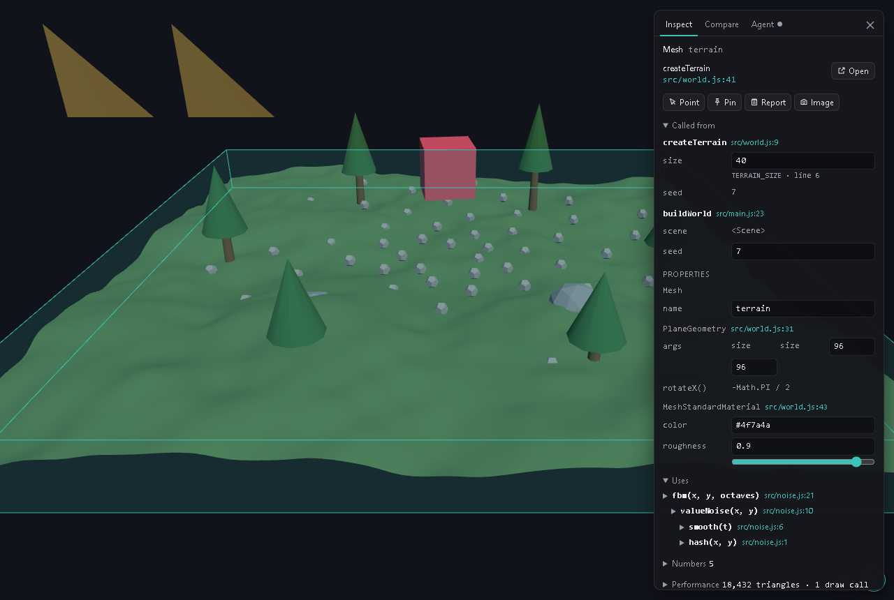
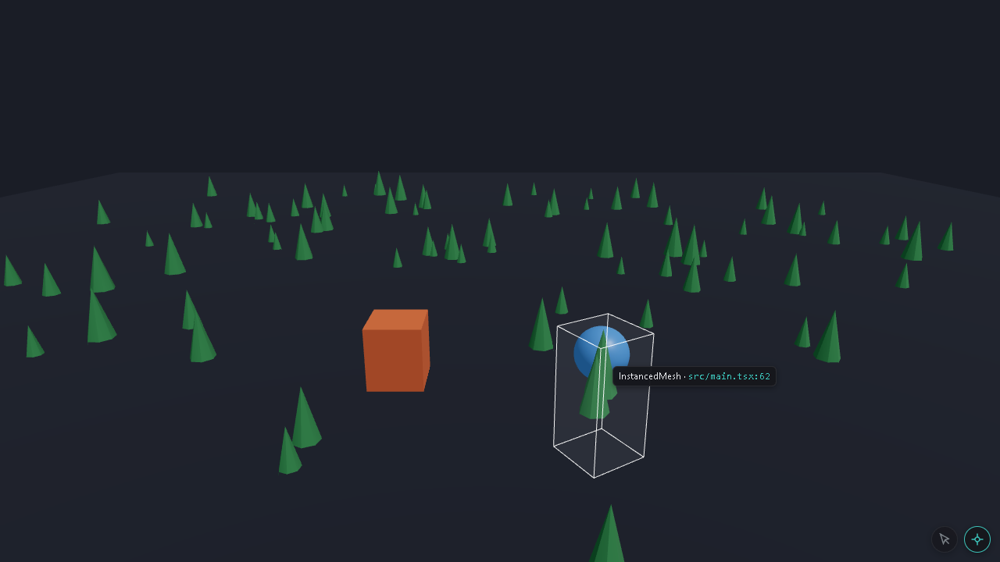
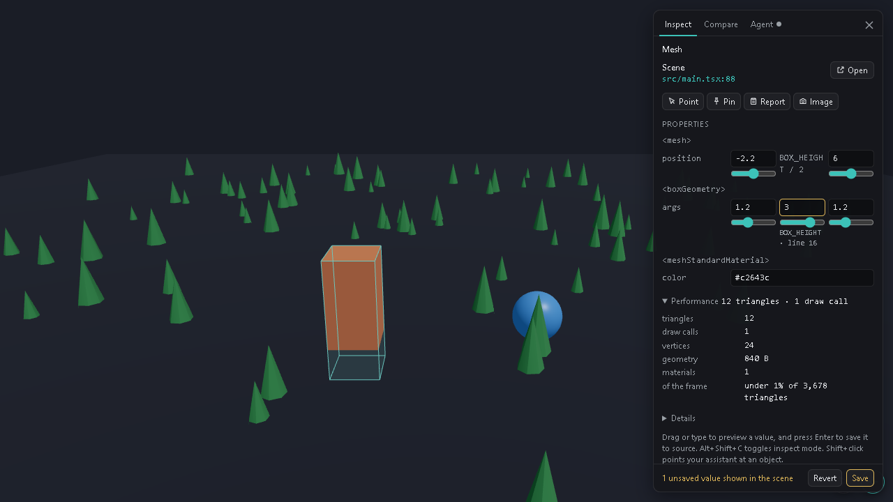
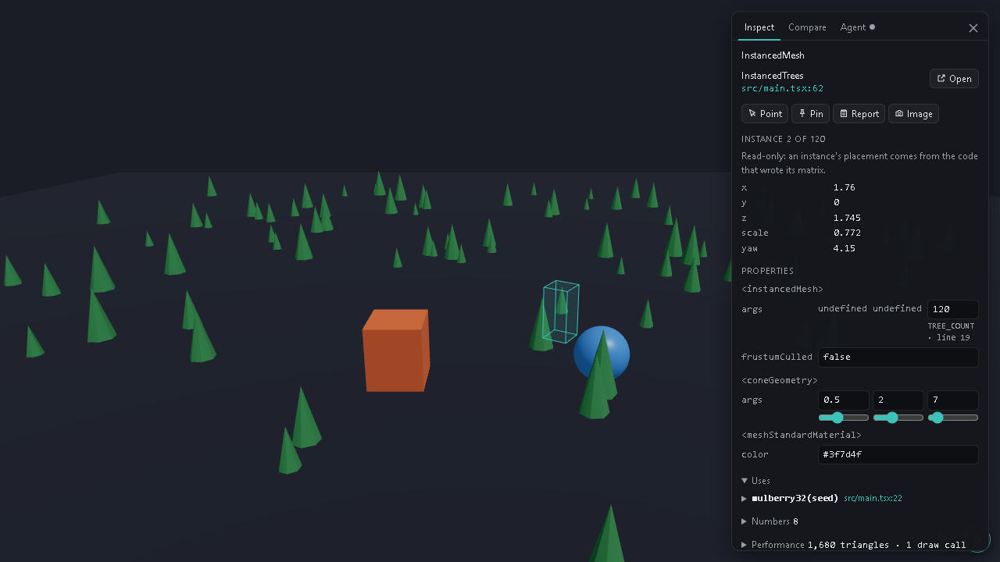
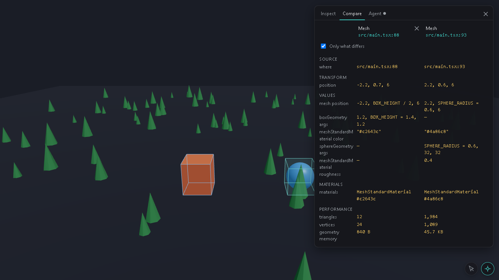
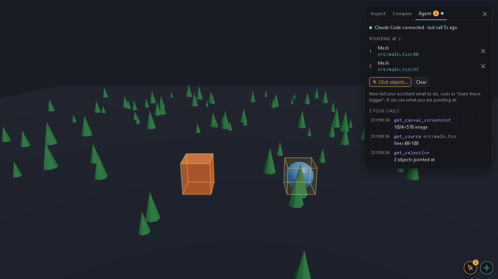

# Click-to-Source 3D

[](https://www.npmjs.com/package/@click-to-source-3d/vite-plugin)
[](https://www.npmjs.com/package/@click-to-source-3d/vite-plugin)
[](https://github.com/pun1th01/click-to-source-3d/actions/workflows/ci.yml)
[](LICENSE)

**Click any mesh in your three.js or React Three Fiber scene to see the line of
code that made it, the calls that led there, and the helpers it used, such as a
noise function. Then change its values right there.**

It works like DevTools' "Inspect Element", but for 3D. It's a Vite plugin that
takes one command to set up, with nothing to add to your code: no imports, no
components, no tags. It also connects to AI coding assistants like Claude Code,
so you can point at a mesh and tell them what to change.

```bash
npx click-to-source-3d init
```



**On this page**

- [Install](#install)
- [Use the inspector](#use-the-inspector)
- [Work with an AI assistant](#work-with-an-ai-assistant)
- [Options](#options)
- [Upgrading](#upgrading)
- [Troubleshooting](#troubleshooting)
- [Removing it](#removing-it)
- [Limits worth knowing](#limits-worth-knowing)
- [How it works](#how-it-works)

## Install

### What you need

| | version |
|---|---|
| Node.js | 20.19 or later |
| three.js | 0.150 or later |
| React Three Fiber, if you use it | 8 or 9 |
| Vite | 5, 6, 7 or 8. If you have no build tool yet, `init` adds Vite for you. |

### Two steps

**1. Set it up.** Open a terminal in your project and run:

```bash
npx click-to-source-3d init
```

There is nothing to edit afterwards, and nothing to add to your code. It tells you
the command that starts your app, which is usually:

```bash
npm run dev
```

**2. Open the app in your browser** and press **Alt+Shift+C**. Click any object.

That's it. The panel opens and shows where the object came from.

### What `init` does

It looks at what you have, and does whatever is missing:

| what it finds | what it does |
|---|---|
| A Vite project with a config | Adds the plugin to the config, whatever shape the config is |
| A Vite project with no config, as `create-vite` makes | Creates `vite.config.js` |
| three.js and no build tool | Installs Vite, adds a `dev` script, creates the config |
| A folder of scripts with no `package.json` | Creates one, and installs the version of three.js your CDN link or import map names |
| Scripts but no `index.html` | Creates a page that loads your entry file |
| A monorepo's root, or a folder inside your app | Finds the apps that use three.js and sets up each one |
| Signs of an AI assistant (`.claude`, `CLAUDE.md`, `.mcp.json`, `.cursor`, `.windsurf`) | [Sets up its tools](#1-connect-your-assistant) without asking |
| A package manager that isn't installed | Runs it through `npx` |

Otherwise it asks one question: whether to set up the tools for AI assistants. If
you don't use one, press Enter to skip it.

It uses your project's package manager (npm, pnpm, yarn or bun). Running it again is
safe, and changes nothing. If it finds webpack, Next.js or another build tool it
doesn't support yet, or a version of Vite or three.js that's too old, it says so,
with the command that updates it if there is one, and changes nothing.

`npx` works with any package manager. If you prefer, `pnpm dlx click-to-source-3d init`
and `bunx click-to-source-3d init` do the same.

| `init` option | what it does |
|---|---|
| `--mcp` | Sets up the assistant tools without asking |
| `--no-mcp` | Doesn't set them up, or ask |
| `-y`, `--yes` | Accepts the defaults without asking |
| `--force` | Sets up a project that doesn't seem to use three.js |

### Setting it up by hand

You shouldn't need to: the only config `init` can't edit is one that exports
nothing, and it prints what to add. This is all it does. Install the plugin:

```bash
npm install -D @click-to-source-3d/vite-plugin
```

With another package manager, use `pnpm add -D`, `yarn add -D` or `bun add -d`.

Then add it to `plugins` in your Vite config:

```js
// vite.config.js (or .ts)
import { defineConfig } from 'vite';
import { clickToSource } from '@click-to-source-3d/vite-plugin';

export default defineConfig({
  plugins: [clickToSource()],
});
```

A config with no single `plugins` list to add to, such as a function that returns
different things, or one built by `mergeConfig`, can be wrapped instead:

```js
import { withClickToSource } from '@click-to-source-3d/vite-plugin';

export default withClickToSource(whateverYouHadBefore);
```

### Try it without a project of your own

The repository has two small example scenes, one in plain three.js and one in
React Three Fiber, with nothing added but the plugin:

```bash
git clone https://github.com/pun1th01/click-to-source-3d.git
```

```bash
cd click-to-source-3d
```

```bash
npm ci
```

```bash
npm run build
```

```bash
npm run dev -w @click-to-source-3d/examples-three
```

```bash
npm run dev -w @click-to-source-3d/examples
```

## Use the inspector

### The controls

| to do this | press |
|---|---|
| Turn inspect mode on or off | **Alt+Shift+C**, or the round button in the bottom-right corner of the canvas |
| See what an object is | Hover over it in inspect mode |
| Open an object in the panel | Click it in inspect mode |
| Move the camera | Drag as usual. Dragging still works in inspect mode |
| Point your assistant at an object | **Shift+click** it in inspect mode |
| Leave inspect mode | **Esc** |
| Close the panel | **Esc** again, or the **×** |

In inspect mode your clicks go to the inspector, so your app's own click handlers
don't fire. Everything goes back to normal when you leave it.

The outlines tell you what's what:

| colour | means |
|---|---|
| White | Under the mouse |
| Teal | Selected, and open in the panel |
| Amber | Pointed out to your assistant |
| Violet | What your assistant is looking at |
| Blue | Pinned for comparing |

### See where an object came from

Press **Alt+Shift+C** and hover over an object. A small label shows its type, file
and line.



Click it. The **Inspect** tab shows the function and line that made it. Press
**Open** to jump to that line in your editor.

### See how it got there

In plain three.js, **Called from** lists the calls that led to the object, nearest
first, with the values they were really given:

```text
createTerrain   src/world.js:9
  size    40      TERRAIN_SIZE · line 6
  seed    7
buildWorld      src/main.js:23
  scene   <Scene>
  seed    7
```

An argument written as a number or a string where the function is called can be
edited right there, wherever that is. One passed along from another function shows
what it was, and the literal is in the frame it came from.

### See what made it

**Uses** lists the helpers behind the object, nested as they call each other, whether
they are yours or come from a package. The numbers inside each are one click away:

```text
fbm(x, y, octaves)   src/noise.js:21
  valueNoise(x, y)   src/noise.js:10
    smooth(t)        src/noise.js:6
    hash(x, y)       src/noise.js:1
createNoise2D        simplex-noise
```

**Numbers** lists every other number in the function that made it, with the line it's
on, so `fbm(x * 0.08, z * 0.08) * 6` is three fields you can change. Top-level code has no
function to look in, so there it means the statements that use what the object was
made from: the loop that moves a geometry's vertices with a noise function counts.

### Change a value

The panel lists the values written for the object, its geometry and its material, wherever
they are written: `new THREE.BoxGeometry(1, 2, 1)`, `{ color: "#c2643c", roughness: 0.5 }`,
`mesh.position.set(0, 1, 2)`, `cube.rotation.y += 0.01` in your animation loop, or in JSX,
`position={[0, 1, 2]}` and `args={[1.2, 2, 1.2]}`.

1. **Drag a slider**, or type a new value. The scene changes straight away, and
   your source file doesn't change yet. Colours work the same way as you type them.
2. **Press Enter**, or **Save** in the bar at the bottom of the panel. Every changed
   value is written to your source at once, in any number of files, with your formatting
   untouched, and Vite reloads it. In plain three.js that's a full page reload, and
   your selection comes back.
3. **Changed your mind?** Press **Revert**, press Esc in the field, or select
   something else, and it all goes back.



Good to know:

- **Constants are followed.** With `args={[1.2, BOX_HEIGHT, 1.2]}` and
  `const BOX_HEIGHT = 1.4` in the same file, the field edits the `const` line. It
  shows `BOX_HEIGHT · line 16` so you can tell.
- **Computed values are read-only.** `noise(x, z) * 8` is shown as code, because
  there's no single number to change.
- **Sliders only reach so far.** Their range is a guess from the value's name and
  size. You can type any number you like.
- **Your edit can't land in the wrong place.** If the file has changed since the
  panel read it, the edit is refused and the panel says so, and nothing is written.
- **Hex stays hex.** `0x88aa55` changed to red is written as `0xff0000`.
- **Some values only show once saved.** Numbers in a loop or a helper can't be shown
  until the code runs again, so they have a field and no slider. So does a geometry whose
  vertices your code moved after making it, since rebuilding it would lose what you did.

### Clones and loaded models

A `mesh.clone()` is found at the line that cloned it. A click on part of a loaded model
is found at the `loader.load()` that loaded it, and the panel says which part it is:
`Part of a model loaded here: Sword › Blade`. Both also work for `loadAsync` and `parse`.

### One instance of an InstancedMesh

Click one tree in an `InstancedMesh` of 120 and you get that one tree: its position,
scale and rotation, and an outline around it alone. Its placement is read-only, but
the geometry and material below it can be edited as usual.



### Find out why something is slow

Open **Performance** in the panel. It shows what the object costs to draw: triangles,
draw calls, vertices, geometry memory, each texture's size and estimated memory,
whether it casts shadows, and its share of the frame.

### Compare two objects

1. Select an object and press **Pin**.
2. Select a second object.
3. Open the **Compare** tab.

The two appear side by side, with differences in amber. Tick **Only what differs** to
hide the rest. You can pin two objects to keep comparing them while you select others;
pinning a third replaces the oldest.



### Copy a bug report

With an object selected:

- **Report** copies its source, transform, values and cost as Markdown. Paste it into
  a doc or chat and a screenshot comes along. Paste it into a plain-text box, such as
  an issue form, and you get the Markdown.
- **Image** copies just a screenshot of the canvas. Paste that into an issue form and
  it uploads the picture.

### After a reload

Inspect mode, your selection, your pins and what you're pointing at all come back
after a page reload, including the one Vite does after an edit to your entry file.

### In production

The plugin does nothing in a build. The inspector is only added to pages the dev
server serves, so none of it reaches your users.

## Work with an AI assistant

Connect an assistant such as Claude Code, Cursor or VS Code with Copilot, and it can
see your running scene. Point at the meshes you mean, then tell it what to do.

### 1. Connect your assistant

Open the inspector's **Agent** tab and press **Turn on MCP server**. Then start your
assistant in that folder, or restart it if it's already running, and allow
click-to-source when it asks. The tab says when it's connected.

The button only registers the server: your assistant is what starts it, so that step
can't be done from the page. You can do the same from a terminal, at any time:

```bash
npx click-to-source-3d init --mcp
```

If your project already has signs of an assistant, such as a `.claude` folder or a
`CLAUDE.md`, plain `init` has already done this.

**Using Claude Code?** That's all. `init` registers the tools in `.mcp.json` at the
root of your repository. Claude Code asks you to approve them the first time it starts
in the project.

**Using Cursor or VS Code?** `init` also writes `.cursor/mcp.json` or `.vscode/mcp.json`
when those folders exist.

**Using something else?** Add this to its own config file:

| assistant | file | top-level key |
|---|---|---|
| Cursor | `.cursor/mcp.json` | `mcpServers` |
| VS Code | `.vscode/mcp.json` | `servers` |

```json
{
  "mcpServers": {
    "click-to-source": { "command": "npx", "args": ["-y", "@click-to-source-3d/mcp"] }
  }
}
```

On Windows, start it through `cmd`:
`"command": "cmd", "args": ["/c", "npx", "-y", "@click-to-source-3d/mcp"]`.

There's nothing else to configure. It finds your running dev server by itself, even if
the dev server starts later or lands on another port.

### 2. Start everything

Start your app with `npm run dev`, open it in your browser, and start your assistant
in the same project. A second round button appears beside the inspect button once the
assistant is connected.

### 3. Point at what you mean

Press the new pointer button, then click one or more objects. Each gets an amber
outline and joins a numbered list in the **Agent** tab. Click one again to remove it.

Two other ways to do the same:

- **Shift+click** objects in inspect mode.
- Press **Point** in the panel for the object you have selected.

What you point at stays until you clear it, even through a reload. If you don't point
at anything, the assistant sees whatever is selected in the panel.

### 4. Tell your assistant what to do

Go to your assistant and type as you normally would:

> make these bigger

> why is this one so slow?

> move the second one next to the first

It knows exactly which objects you mean, with the file, line and every editable value
of each, the calls that led to them and the helpers they used.

### 5. Watch what it does

The **Agent** tab shows which assistant is connected and every tool call, in plain
words, with edits marked and errors in red. Objects it asks about get a violet outline
for a moment. Click a line in the log to select that object, or to open that line in
your editor if the scene doesn't have it.



An assistant can also edit files with its own tools, as it can with any file. Those
edits still hot-reload, but only the ones it makes through Click-to-Source appear in
the log.

### What an assistant can do

| tool | what it does |
|---|---|
| `get_selection` | Reads what you are pointing at and have selected |
| `edit_parameter` | Changes one value in your source |
| `get_canvas_screenshot` | Looks at the scene as you see it |
| `highlight_object` | Outlines objects on your screen to show you what it means |
| `list_scene_provenance` | Lists what is in the running scene |
| `resolve_at_point` | Asks what is under a point on screen |
| `get_instance_provenance` | Asks about one object, or one instance |
| `get_source` | Reads the code that made something |
| `list_files`, `list_provenance`, `search_by_generator` | Searches your source |

The [MCP package](packages/mcp/) has the details.

## Options

`clickToSource()` needs no options. If you want to change something:

```js
clickToSource({
  inspector: {
    hotkey: 'ctrl+shift+x', // instead of Alt+Shift+C
    button: false,          // hide the buttons on the canvas
  },
});
```

| option | default | what it does |
|---|---|---|
| `inspector` | on | `false` turns the inspector off. An object sets `hotkey` and `button`. |
| `bridge` | on | `false` cuts off AI assistants from the running page. |
| `stampSource` | on | `false` stops recording where objects come from. |
| `allowRemote` | off | Lets other machines use the endpoints under `vite --host`. Only turn this on for a network you control. |
| `allowedOrigins` | the dev server's | Extra browser origins allowed to call the endpoints. |
| `allowedExtensions` | source files | File types that can be read and edited. |

The [plugin's README](packages/vite-plugin/) has the details.

## Upgrading

### From 0.1.6

Update the plugin, and the assistant tools if you use them. Nothing changes in your
config or your app.

```bash
npm install -D @click-to-source-3d/vite-plugin@latest @click-to-source-3d/mcp@latest
```

These old things were removed, so if you still have them, delete them first:

- The `captureInstances` option to `clickToSource()`, which already did nothing.
- `<ClickToSourceBridge />` from `@click-to-source-3d/overlay`. The plugin has done its
  job since 0.1.5.
- `@click-to-source-3d/core/probe` and `installInstanceProbe`. Instances are read live.

### From 0.1.5

Update the plugin, and the assistant tools if you use them. The two need to be on the
same version. Nothing changes in your config or your app.

```bash
npm install -D @click-to-source-3d/vite-plugin@latest @click-to-source-3d/mcp@latest
```

### From 0.1.4 or earlier

1. **Update the same way.** Leave out `@click-to-source-3d/mcp` if you don't use it.

   ```bash
   npm install -D @click-to-source-3d/vite-plugin@latest @click-to-source-3d/mcp@latest
   ```

2. **Simplify the config.** `clickToSource({ stampSource: true, bridge: true })`
   becomes `clickToSource()`. `captureInstances` no longer does anything and can go.

3. **Remove the old wiring.** Delete `<SelectionHighlight />`, `<GenerationTrace />`,
   `<ClickToSourceBridge />`, your click handler and `onPointerMissed`, then uninstall
   the old package.

   ```bash
   npm uninstall @click-to-source-3d/overlay
   ```

4. **Drop the MCP environment variables.** `CTS_DEV_SERVER` and `CTS_PROJECT_ROOT` are
   no longer needed, though they still override what the server finds.

Hand-written `userData.sourceRef` metadata is no longer needed. It still works, and
still wins where you have it.

## Troubleshooting

**No button, and Alt+Shift+C does nothing.**
- The inspector only exists on the dev server (`vite` or `npm run dev`), not in
  `vite build` or `vite preview` output.
- Check that `clickToSource()` is in `plugins`.
- The button appears once a canvas has rendered.
- In the browser console, `__CTS_DEVTOOLS__` should print an object. If it's
  `undefined`, the plugin isn't running on this page, so restart the dev server.

**No pointer button.** It appears once an assistant is connected, so check that yours
is running in this project. The **Agent** tab works either way and says how to connect
one, and Shift+click in inspect mode always points.

**The assistant says nothing is pointed at.** Make sure the plugin and
`@click-to-source-3d/mcp` are on the same version. Then check the **Agent** tab: your
objects should be listed, and your assistant named as connected. In a monorepo, start
the assistant in or above the app's folder so it finds the right dev server.

**The assistant doesn't use what I pointed at.** Ask it directly: "use get_selection to
see what I'm pointing at".

**Report copies no screenshot.** A plain-text box only takes text, so it gets the
Markdown. Press **Image** and paste again to add the picture.

**Copying fails on another device.** Browsers only offer full clipboard access on
`localhost` or `https`. Over plain `http`, as with `vite --host`, **Report** copies text
only and **Image** isn't available.

**Alt+Shift+C is already taken.** Choose another shortcut in [Options](#options).

**Open starts the wrong editor.** Set the `LAUNCH_EDITOR` environment variable before
starting the dev server, for example to `code`, `cursor` or `webstorm`.

**An object shows "No source found".** Something other than your code made it: a library, or a
page's classic script. The panel names its parents so you can find the nearest thing of yours.

**Setup says it found no three.js project.** Run it in the folder with your app, or the root of your
monorepo. If you haven't written any three.js yet, add `--force`.

**My app stopped working after setup.** Please [open an issue](https://github.com/pun1th01/click-to-source-3d/issues/new/choose).
Meanwhile, `clickToSource({ stampSource: false })` turns off everything that touches your code.

## Removing it

Delete `clickToSource()` and its import from your Vite config (or `withClickToSource`, if
that's what `init` used), then uninstall the plugin:

```bash
npm uninstall @click-to-source-3d/vite-plugin
```

If you set up the assistant tools, also uninstall `@click-to-source-3d/mcp` and remove
the `click-to-source` entry from `.mcp.json`.

## Limits worth knowing

**Vite only, for now.** webpack and Next.js are on the roadmap. So are Astro and Nuxt, which
use Vite but keep its config in a file of their own.

**Not everything is on the call stack.** `async` functions and generators leave it at their first
pause, so they don't appear in **Called from**. What they make is still found, at its own line.

**Uses and Called from come from reading your code.** A call through a variable holding a function, or
a callback passed around, can't always be followed. When it can't, the helper isn't listed. Nothing is
ever wrong as a result, only missing.

**Your code is served slightly changed in development.** Each `new` and each call to a function that
makes objects gets a small record around it, on the same line. Your files aren't touched, your objects
have nothing added, and none of it reaches a build. Math types, such as `Vector3`, are skipped, so a
tight loop costs nothing extra.

**Classic scripts can't be read.** A `<script src="...">` with no `type="module"` can't import anything,
so what it makes is highlighted, but shows no source. A script written inside the page with
`type="module"` works, and is edited in the page.

**Vue and Svelte components aren't read yet.** Three.js code in a `.vue` or `.svelte` file shows no
source, though the `.js` and `.ts` files they import do.

**WebGPU has only been tried through its WebGL backend.** `WebGPURenderer` is found and picked, but no
test here has run on a real GPU.

**What counts as an element in JSX is a lowercase tag.** `<mesh>`, `<group>`,
`<instancedMesh>` and wrappers such as `<animated.mesh>` are tracked. A library component
such as drei's `<Box>` renders its own elements inside the library, so its objects
resolve to the nearest element of yours, or to "no source found".

**Editable means a literal.** A value computed at runtime, a prop passed in from a
parent, or a constant imported from another file is shown but can't be edited. A constant
in the same file is followed only when nothing else in the file has the same name. A call's
argument is the exception: it can be edited wherever the call is, in any file.

**An instance's placement is read-only.** It comes from whatever wrote its matrix, usually
a loop, so there's no single number in your source to change.

**An instance's transform is all that is known about it.** Which colour group, species or
variant it belongs to isn't in a transform. Write `userData.instanceSourceRefs` by hand if
you need that.

**A preview shows one object.** It changes the object in the panel, not everything that
uses the same value. A constant used by other objects, or inside an expression such as
`BOX_HEIGHT / 2`, updates everywhere only once saved. A slider appears only where the live
object can show the change, so a custom geometry, or an element's own `args`, has just the
text field.

**Values are found by name.** `mesh.position.set(1, 2, 3)` counts if `mesh` is the variable the object
was first put in. Passed to a helper and changed there, it isn't connected to the object.

**Costs are worked out, not measured.** The Performance section adds up what the object asks
of the GPU if all of it is on screen, before shadow passes. Texture memory is an estimate.

**Scene addresses don't detect a regenerated world.** They survive a remount, but if your
world is rebuilt with different placements, the same address names a different object.

**A background tab may be slow to answer an assistant.** What you're pointing at is answered
by the dev server, so that always works. A screenshot from a background tab is drawn just
for the assistant, without any post-processing your app does. A browser can freeze a tab left
long enough in the background, and tools that ask the page then report a timeout.

## How it works

- **While Vite serves your code,** the plugin reads it, following imports across your project, to
  work out which functions end up making three.js objects. It adds a record of where each object comes
  from: file, function, line and column, and the exact position of each value. In JSX that's on the
  element. In plain code it's kept to one side, in a table the object isn't in. Your source files aren't
  changed, only the code Vite serves in development.
- **In the page,** the plugin adds the inspector before your app loads. It finds your renderers
  through three.js's own devtools hook, draws its outlines after your frame rather than taking
  over the render loop, so post-processing keeps working, and lives in a shadow root your CSS
  can't touch.
- **On the dev server,** a few endpoints read files, rewrite a single value, and open your editor.
  They answer only to the page itself and to programs on your machine, and only for source files
  inside the project.
- **For an assistant,** the MCP server talks to your dev server, which passes each call on to the
  page so you can see it. Nothing leaves your machine except what your assistant itself sends to
  its own model.

## Packages

You only install one: the plugin, which `init` does for you.

| package | what it is |
|---|---|
| `@click-to-source-3d/vite-plugin` | **The one you install.** The inspector and everything behind it. |
| `click-to-source-3d` | The `init` command. Run with `npx`; never added to your project. |
| `@click-to-source-3d/mcp` | Optional. The tools for AI assistants. |
| `@click-to-source-3d/core` | Internal, bundled into the plugin. |
| `@click-to-source-3d/shared` | Internal. The types both halves agree on. |
| `@click-to-source-3d/overlay` | **Legacy.** The React components from before the inspector was built in. Removed in a later release. |

## Roadmap

| Stage | Milestone | Status |
|-------|-----------|--------|
| 0–6.5 | Proof, convention, engine, dogfooding, packaging, MCP, stamping | done |
| 7 | Ship | done — first release `0.1.0` |
| 8 | One command, no wiring, for R3F | done — `0.1.5` |
| 8.5 | Point an assistant at meshes, the Agent tab, live previews | done — `0.1.6` |
| 9 | Plain three.js, nothing tagged, and no setup at all | done — `0.2.0` |

The full plan is in
[`docs/roadmap/`](docs/roadmap/Click-to-Source_Implementation_Plan_0.1.5-0.2.0.pdf), and what
changed in each release is in [`CHANGELOG.md`](CHANGELOG.md).

## Repository structure

```
click-to-source/
├── packages/
│   ├── vite-plugin/   # the plugin: stamping, injected inspector, endpoints
│   ├── cli/           # npx click-to-source-3d init
│   ├── mcp/           # MCP server for AI coding assistants
│   ├── core/          # resolution, picking, highlight (bundled into the plugin)
│   ├── shared/        # types shared by both halves
│   ├── overlay/       # legacy React components
│   ├── examples/      # an R3F scene with only the plugin added
│   └── examples-three/ # a plain three.js scene with only the plugin added
├── e2e/               # browser tests against the examples
└── docs/              # architecture notes, research, roadmap
```

## Contributing

Contributions are welcome! Please read the [Contributing Guidelines](CONTRIBUTING.md)
and our [Code of Conduct](CODE_OF_CONDUCT.md).

- **Questions and ideas:** [Discussions](https://github.com/pun1th01/click-to-source-3d/discussions), or see [getting help](SUPPORT.md)
- **Bugs and feature requests:** [open an issue](https://github.com/pun1th01/click-to-source-3d/issues/new/choose)
- **Security problems:** please report them privately, as the [security policy](SECURITY.md) explains

## License

This project is licensed under the [MIT License](LICENSE).

---

<sub>Click-to-Source 3D is an open-source developer tool. Built for the Three.js and React Three Fiber community.</sub>
