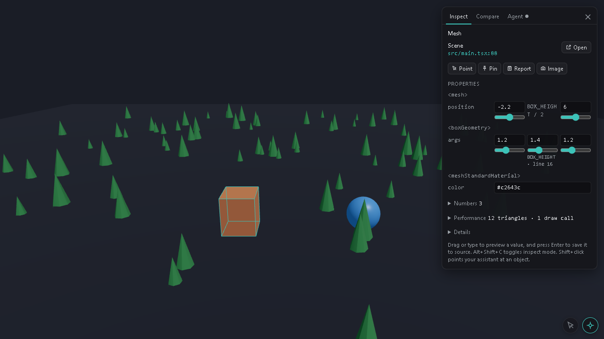

# Click-to-Source 3D

[](https://github.com/pun1th01/click-to-source-3d/actions/workflows/ci.yml)

**Click any object in your React Three Fiber scene to see the line of code that
created it, and change its values right there.**

It works like DevTools' "Inspect Element", but for 3D. There is nothing to add
to your code: no imports, no components, no tags.



**On this page**

- [Install](#install)
- [Use the inspector](#use-the-inspector)
- [Work with an AI assistant](#work-with-an-ai-assistant)
- [Options](#options)
- [Upgrading](#upgrading)
- [Troubleshooting](#troubleshooting)
- [Removing it](#removing-it)
- [Limits worth knowing](#limits-worth-knowing)
- [How it works](#how-it-works)

## Install

### What you need

A React Three Fiber app that runs on Vite:

| | version |
|---|---|
| Node.js | 20.19 or later |
| Vite | 6, 7 or 8 |
| React Three Fiber | 9 |
| three.js | 0.170 or later |

### Three steps

**1. Set it up.** Open a terminal in your app's folder, the one with
`package.json` and `vite.config`, and run:

```bash
npx click-to-source-3d init
```

It asks one question: whether to set up the tools for AI assistants. If you
don't use one, press Enter to skip it. You can [add them later](#1-connect-your-assistant).

**2. Start your app** the way you normally do:

```bash
npm run dev
```

**3. Open the app in your browser** and press **Alt+Shift+C**. Click any object.

That's it. The panel opens and shows where the object came from.

### What `init` changed

- It installed `@click-to-source-3d/vite-plugin` as a dev dependency, using your
  project's package manager (npm, pnpm, yarn or bun).
- It added `clickToSource()` to the `plugins` in your `vite.config`. Nothing else
  in the file changes.
- If you said yes to the question, it also set up the assistant tools.

Running it again is safe, and changes nothing. `npx` works with any package
manager. If you prefer, `pnpm dlx click-to-source-3d init` and
`bunx click-to-source-3d init` do the same.

| `init` option | what it does |
|---|---|
| `--mcp` | Sets up the assistant tools without asking |
| `--no-mcp` | Skips the question |
| `-y`, `--yes` | Accepts the defaults without asking |
| `--force` | Sets up a project that doesn't use React Three Fiber |

### Setting it up by hand

If `init` can't edit your config safely, it prints what to add instead. This is
all it does. Install the plugin:

```bash
npm install -D @click-to-source-3d/vite-plugin
```

With another package manager, use `pnpm add -D`, `yarn add -D` or `bun add -d`.

Then add it to `plugins` in your Vite config, before or after `react()`:

```js
// vite.config.js (or .ts)
import { defineConfig } from 'vite';
import react from '@vitejs/plugin-react';
import { clickToSource } from '@click-to-source-3d/vite-plugin';

export default defineConfig({
  plugins: [clickToSource(), react()],
});
```

### Try it without a project of your own

The repository has a small example scene:

```bash
git clone https://github.com/pun1th01/click-to-source-3d.git
```

```bash
cd click-to-source-3d
```

```bash
npm ci
```

```bash
npm run build
```

```bash
npm run dev -w @click-to-source-3d/examples
```

## Use the inspector

### The controls

| to do this | press |
|---|---|
| Turn inspect mode on or off | **Alt+Shift+C**, or the round button in the bottom-right corner of the canvas |
| See what an object is | Hover over it in inspect mode |
| Open an object in the panel | Click it in inspect mode |
| Move the camera | Drag as usual. Dragging still works in inspect mode |
| Point your assistant at an object | **Shift+click** it in inspect mode |
| Leave inspect mode | **Esc** |
| Close the panel | **Esc** again, or the **×** |

In inspect mode your clicks go to the inspector, so your app's own click handlers
don't fire. Everything goes back to normal when you leave it.

The outlines tell you what's what:

| colour | means |
|---|---|
| White | Under the mouse |
| Teal | Selected, and open in the panel |
| Amber | Pointed out to your assistant |
| Violet | What your assistant is looking at |
| Blue | Pinned for comparing |

### See where an object came from

Press **Alt+Shift+C** and hover over an object. A small label shows its type, file
and line.


Click it. The **Inspect** tab shows the component and line that created it. Press
**Open** to jump to that line in your editor.

### Change a value

The panel lists the values written on the object, and on the geometry and material
inside it: `position={[0, 1, 2]}`, `args={[1.2, 2, 1.2]}`, `color="#c2643c"`.

1. **Drag a slider**, or type a new value. The scene changes straight away, and
   your source file doesn't change yet.
2. **Press Enter**, or **Save** in the bar at the bottom of the panel. Every changed
   value is written to your source, with your formatting untouched, and Vite
   hot-reloads it.
3. **Changed your mind?** Press **Revert**, press Esc in the field, or select
   something else, and it all goes back.


Good to know:

- **Constants are followed.** With `args={[1.2, BOX_HEIGHT, 1.2]}` and
  `const BOX_HEIGHT = 1.4` in the same file, the field edits the `const` line. It
  shows `BOX_HEIGHT · line 16` so you can tell.
- **Computed values are read-only.** `noise(x, z) * 8` is shown as code, because
  there's no single number to change.
- **Sliders only reach so far.** Their range is a guess from the value's name and
  size. You can type any number you like.
- **Your edit can't land in the wrong place.** If the file has changed since the
  panel read it, the edit is refused and the panel says so.

### One instance of an InstancedMesh

Click one tree in an `InstancedMesh` of 120 and you get that one tree: its position,
scale and rotation, and an outline around it alone. Its placement is read-only, but
the geometry and material below it can be edited as usual.


### Find out why something is slow

Open **Performance** in the panel. It shows what the object costs to draw: triangles,
draw calls, vertices, geometry memory, each texture's size and estimated memory,
whether it casts shadows, and its share of the frame.

### Compare two objects

1. Select an object and press **Pin**.
2. Select a second object.
3. Open the **Compare** tab.

The two appear side by side, with differences in amber. Tick **Only what differs** to
hide the rest. You can pin two objects to keep comparing them while you select others;
pinning a third replaces the oldest.


### Copy a bug report

With an object selected:

- **Report** copies its source, transform, values and cost as Markdown. Paste it into
  a doc or chat and a screenshot comes along. Paste it into a plain-text box, such as
  an issue form, and you get the Markdown.
- **Image** copies just a screenshot of the canvas. Paste that into an issue form and
  it uploads the picture.

### After a reload

Inspect mode, your selection, your pins and what you're pointing at all come back
after a page reload, including the one Vite does after an edit to your entry file.

### In production

The plugin does nothing in a build. The inspector is only added to pages the dev
server serves, so none of it reaches your users.

## Work with an AI assistant

Connect an assistant such as Claude Code, Cursor or VS Code with Copilot, and it can
see your running scene. Point at the meshes you mean, then tell it what to do.

### 1. Connect your assistant

Answer yes when `init` asks, or run this at any time:

```bash
npx click-to-source-3d init --mcp
```

**Using Claude Code?** That's all. `init` registers the tools in `.mcp.json` at the
root of your repository. Claude Code asks you to approve them the first time it starts
in the project.

**Using something else?** Add this to its own config file:

| assistant | file | top-level key |
|---|---|---|
| Cursor | `.cursor/mcp.json` | `mcpServers` |
| VS Code | `.vscode/mcp.json` | `servers` |

```json
{
  "mcpServers": {
    "click-to-source": { "command": "npx", "args": ["-y", "@click-to-source-3d/mcp"] }
  }
}
```

On Windows, start it through `cmd`:
`"command": "cmd", "args": ["/c", "npx", "-y", "@click-to-source-3d/mcp"]`.

There's nothing else to configure. It finds your running dev server by itself, even if
the dev server starts later or lands on another port.

### 2. Start everything

Start your app with `npm run dev`, open it in your browser, and start your assistant
in the same project. A second round button appears beside the inspect button once the
assistant is connected.

### 3. Point at what you mean

Press the new pointer button, then click one or more objects. Each gets an amber
outline and joins a numbered list in the **Agent** tab. Click one again to remove it.

Two other ways to do the same:

- **Shift+click** objects in inspect mode.
- Press **Point** in the panel for the object you have selected.

What you point at stays until you clear it, even through a reload. If you don't point
at anything, the assistant sees whatever is selected in the panel.

### 4. Tell your assistant what to do

Go to your assistant and type as you normally would:

> make these bigger

> why is this one so slow?

> move the second one next to the first

It knows exactly which objects you mean, with the file, line and every editable value
of each.

### 5. Watch what it does

The **Agent** tab shows which assistant is connected and every tool call, in plain
words, with edits marked and errors in red. Objects it asks about get a violet outline
for a moment. Click a line in the log to select that object, or to open that line in
your editor if the scene doesn't have it.


An assistant can also edit files with its own tools, as it can with any file. Those
edits still hot-reload, but only the ones it makes through Click-to-Source appear in
the log.

### What an assistant can do

| tool | what it does |
|---|---|
| `get_selection` | Reads what you are pointing at and have selected |
| `edit_parameter` | Changes one value in your source |
| `get_canvas_screenshot` | Looks at the scene as you see it |
| `highlight_object` | Outlines objects on your screen to show you what it means |
| `list_scene_provenance` | Lists what is in the running scene |
| `resolve_at_point` | Asks what is under a point on screen |
| `get_instance_provenance` | Asks about one object, or one instance |
| `get_source` | Reads the code that made something |
| `list_files`, `list_provenance`, `search_by_generator` | Searches your source |

The [MCP package](packages/mcp/) has the details.

## Options

`clickToSource()` needs no options. If you want to change something:

```js
clickToSource({
  inspector: {
    hotkey: 'ctrl+shift+x', // instead of Alt+Shift+C
    button: false,          // hide the buttons on the canvas
  },
});
```

| option | default | what it does |
|---|---|---|
| `inspector` | on | `false` turns the inspector off. An object sets `hotkey` and `button`. |
| `bridge` | on | `false` cuts off AI assistants from the running page. |
| `stampSource` | on | `false` stops recording where objects come from. |
| `allowRemote` | off | Lets other machines use the endpoints under `vite --host`. Only turn this on for a network you control. |
| `allowedOrigins` | the dev server's | Extra browser origins allowed to call the endpoints. |
| `allowedExtensions` | source files | File types that can be read and edited. |

The [plugin's README](packages/vite-plugin/) has the details.

## Upgrading

### From 0.1.5

Update the plugin, and the assistant tools if you use them. The two need to be on the
same version. Nothing changes in your config or your app.

```bash
npm install -D @click-to-source-3d/vite-plugin@latest @click-to-source-3d/mcp@latest
```

### From 0.1.4 or earlier

1. **Update the same way.** Leave out `@click-to-source-3d/mcp` if you don't use it.

   ```bash
   npm install -D @click-to-source-3d/vite-plugin@latest @click-to-source-3d/mcp@latest
   ```

2. **Simplify the config.** `clickToSource({ stampSource: true, bridge: true })`
   becomes `clickToSource()`. `captureInstances` no longer does anything and can go.

3. **Remove the old wiring.** Delete `<SelectionHighlight />`, `<GenerationTrace />`,
   `<ClickToSourceBridge />`, your click handler and `onPointerMissed`, then uninstall
   the old package. Until you do, they keep working next to the built-in inspector,
   and the console says once that they can go.

   ```bash
   npm uninstall @click-to-source-3d/overlay
   ```

4. **Drop the MCP environment variables.** `CTS_DEV_SERVER` and `CTS_PROJECT_ROOT` are
   no longer needed, though they still override what the server finds.

Hand-written `userData.sourceRef` metadata is no longer needed. It still works, and
still wins where you have it.

## Troubleshooting

**No button, and Alt+Shift+C does nothing.**
- The inspector only exists on the dev server (`vite` or `npm run dev`), not in
  `vite build` or `vite preview` output.
- Check that `clickToSource()` is in `plugins`.
- The button appears once a canvas has rendered.
- In the browser console, `__CTS_DEVTOOLS__` should print an object. If it's
  `undefined`, the plugin isn't running on this page, so restart the dev server.

**No pointer button.** It appears once an assistant is connected, so check that yours
is running in this project. The **Agent** tab works either way and says how to connect
one, and Shift+click in inspect mode always points.

**The assistant says nothing is pointed at.** Make sure the plugin and
`@click-to-source-3d/mcp` are on the same version. Then check the **Agent** tab: your
objects should be listed, and your assistant named as connected. In a monorepo, start
the assistant in or above the app's folder so it finds the right dev server.

**The assistant doesn't use what I pointed at.** Ask it directly: "use get_selection to
see what I'm pointing at".

**Report copies no screenshot.** A plain-text box only takes text, so it gets the
Markdown. Press **Image** and paste again to add the picture.

**Copying fails on another device.** Browsers only offer full clipboard access on
`localhost` or `https`. Over plain `http`, as with `vite --host`, **Report** copies text
only and **Image** isn't available.

**Alt+Shift+C is already taken.** Choose another shortcut in [Options](#options).

**Open starts the wrong editor.** Set the `LAUNCH_EDITOR` environment variable before
starting the dev server, for example to `code`, `cursor` or `webstorm`.

**An object shows "No source found".** A library component, such as drei's `<Box>`, or
code that isn't JSX created it. The panel names its parents so you can find the nearest
element of yours.

## Removing it

Delete `clickToSource()` and its import from your Vite config, then uninstall the
plugin:

```bash
npm uninstall @click-to-source-3d/vite-plugin
```

If you set up the assistant tools, also uninstall `@click-to-source-3d/mcp` and remove
the `click-to-source` entry from `.mcp.json`.

## Limits worth knowing

**React Three Fiber on Vite only, for now.** Plain three.js, with nothing tagged by hand,
is the next milestone (`0.2.0`). webpack and Next.js are on the roadmap.

**What counts as an element is a lowercase JSX tag.** `<mesh>`, `<group>`,
`<instancedMesh>` and wrappers such as `<animated.mesh>` are tracked. A library component
such as drei's `<Box>` renders its own elements inside the library, so its objects
resolve to the nearest element of yours, or to "no source found".

**Editable means a literal.** A value computed at runtime, a prop passed in from a
parent, or a constant imported from another file is shown but can't be edited. A constant
in the same file is followed only when nothing else in the file has the same name.

**An instance's placement is read-only.** It comes from whatever wrote its matrix, usually
a loop, so there's no single number in your source to change.

**An instance's transform is all that is known about it.** Which colour group, species or
variant it belongs to isn't in a transform. Write `userData.instanceSourceRefs` by hand if
you need that.

**A preview shows one object.** It changes the object in the panel, not everything that
uses the same value. A constant used by other objects, or inside an expression such as
`BOX_HEIGHT / 2`, updates everywhere only once saved. A slider appears only where the live
object can show the change, so a custom geometry, or an element's own `args`, has just the
text field.

**Costs are worked out, not measured.** The Performance section adds up what the object asks
of the GPU if all of it is on screen, before shadow passes. Texture memory is an estimate.

**Scene addresses don't detect a regenerated world.** They survive a remount, but if your
world is rebuilt with different placements, the same address names a different object.

**A background tab may be slow to answer an assistant.** What you're pointing at is answered
by the dev server, so that always works. A screenshot from a background tab is drawn just
for the assistant, without any post-processing your app does. A browser can freeze a tab left
long enough in the background, and tools that ask the page then report a timeout.

## How it works

- **While Vite serves your code,** the plugin gives every three.js element in your JSX a small
  record of where it is: file, component, line and column, and the exact position of each
  value. Your source files aren't changed, only the code Vite serves in development.
- **In the page,** the plugin adds the inspector before your app loads. It finds your renderers
  through three.js's own devtools hook, draws its outlines after your frame rather than taking
  over the render loop, so post-processing keeps working, and lives in a shadow root your CSS
  can't touch.
- **On the dev server,** a few endpoints read files, rewrite a single value, and open your editor.
  They answer only to the page itself and to programs on your machine, and only for source files
  inside the project.
- **For an assistant,** the MCP server talks to your dev server, which passes each call on to the
  page so you can see it. Nothing leaves your machine except what your assistant itself sends to
  its own model.

## Packages

You only install one: the plugin, which `init` does for you.

| package | what it is |
|---|---|
| `@click-to-source-3d/vite-plugin` | **The one you install.** The inspector and everything behind it. |
| `click-to-source-3d` | The `init` command. Run with `npx`; never added to your project. |
| `@click-to-source-3d/mcp` | Optional. The tools for AI assistants. |
| `@click-to-source-3d/core` | Internal, bundled into the plugin. |
| `@click-to-source-3d/shared` | Internal. The types both halves agree on. |
| `@click-to-source-3d/overlay` | **Legacy.** The React components from before the inspector was built in. Removed in a later release. |

## Roadmap

| Stage | Milestone | Status |
|-------|-----------|--------|
| 0–6.5 | Proof, convention, engine, dogfooding, packaging, MCP, stamping | done |
| 7 | Ship | done — first release `0.1.0` |
| 8 | One command, no wiring, for R3F | done — `0.1.5` |
| 8.5 | Point an assistant at meshes, the Agent tab, live previews | done — `0.1.6` |
| 9 | Plain three.js, nothing tagged | next — `0.2.0` |

**Stage 9** brings the inspector to plain three.js. Click a mesh and see the line that created
it, the chain of calls that led there with the values they were called with, and the helpers
they used, such as a noise function. `0.2.0` will be the first version to support both three.js
and React Three Fiber.

The full plan is in
[`docs/roadmap/`](docs/roadmap/Click-to-Source_Implementation_Plan_0.1.5-0.2.0.pdf), and what
changed in each release is in [`CHANGELOG.md`](CHANGELOG.md).

## Repository structure

```
click-to-source/
├── packages/
│   ├── vite-plugin/   # the plugin: stamping, injected inspector, endpoints
│   ├── cli/           # npx click-to-source-3d init
│   ├── mcp/           # MCP server for AI coding assistants
│   ├── core/          # resolution, picking, highlight (bundled into the plugin)
│   ├── shared/        # types shared by both halves
│   ├── overlay/       # legacy React components
│   └── examples/      # a plain R3F scene with only the plugin added
├── e2e/               # browser tests against the example
└── docs/              # architecture notes, research, roadmap
```

## Contributing

Contributions are welcome! Please read the [Contributing Guidelines](CONTRIBUTING.md).
Participants are expected to follow the [Contributor Covenant](https://www.contributor-covenant.org/version/2/1/code_of_conduct/).
If you are opening an issue, please use the provided [Issue Templates](.github/ISSUE_TEMPLATE/).

## License

This project is licensed under the [MIT License](LICENSE).

---

<sub>Click-to-Source 3D is an open-source developer tool. Built for the Three.js and React Three Fiber community.</sub>
